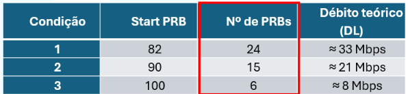

# Experimental Laboratory Tests

<p align="center">
  
  
</p>

# Experimental Laboratory Tests LoS and NLoS

<p align="center">
  
  
</p>

This section documents the ten experimental tests performed during the 5G NR Standalone project.

# Radio Configuration
## KPI dashboard view


# 1. Channel bandwidth impact.
## 20Mhz


## 40Mhz


# 2. Carrier frequency variation.
## n77


## n78


# 3. TDD slot configuration.
## DDDFU


## DDFUU


# 4. FDD operation.
## DDDFU


## DDFUU


# 5. Modulation and Coding Scheme (MCS).


# 6. MIMO configuration.
## SISO


## MIMO


# Protocols and Security
# 8. 5G NR security analysis.
## Cipher


## No Cipher


# Advanced 5G Features and Wireshark Analysis
# Wireshark Protocol and Signalling Analysis

## Objective

Wireshark was used for packet capture, protocol inspection and Deep Packet Inspection (DPI) within the experimental 5G NR Standalone network.

## Capture Interfaces

- `oai-cn5g`
- `lo` (Loopback)

## Display Filters

### NGAP

```wireshark
ngap
```

Used to inspect the NG Setup procedure, including NGSetupRequest and NGSetupResponse messages exchanged between the gNB and AMF.

### ICMP

```wireshark
icmp
```

Used to inspect ICMP Echo Request and Echo Reply packets during connectivity testing.

## Protocol Layers Observed

- MAC-NR
- RLC-NR
- PDCP-NR
- SDAP
- NGAP
- NAS
- GTP-U

## User Plane Analysis

The project investigated packet processing across:

- Uu: Radio protocol stack.
- N3: GTP-U tunnelling between gNB and UPF.
- N6: Forwarding towards the external data network after tunnel decapsulation.

## Security Analysis

The experiments also investigated 5G-AKA authentication and security mechanisms affecting NAS signalling and user-plane traffic.

Screenshots included in this folder should be taken from the actual laboratory captures and sanitized before publication.

# 9. Network slicing using an xApp.
## URLLC


## PRbs


10. PLMN configuration and 5G SIM programming.

Each experiment should include its objective, configuration, methodology, evidence, results and conclusions.
